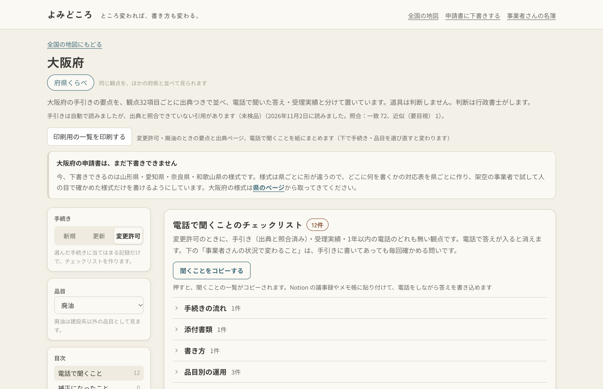
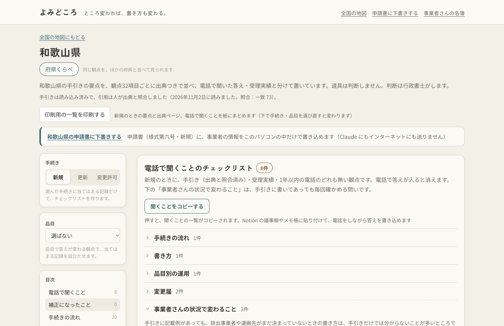
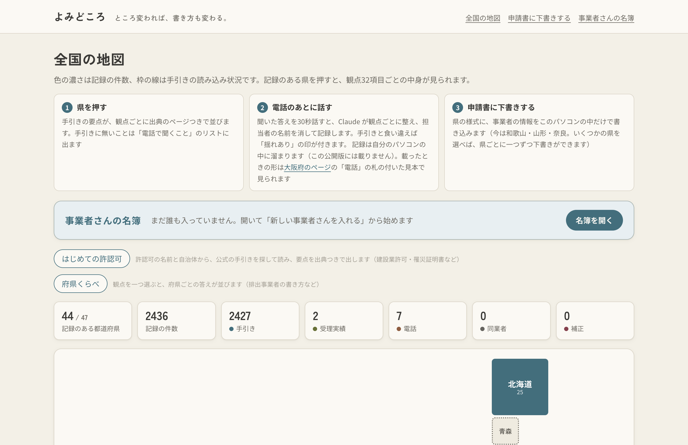
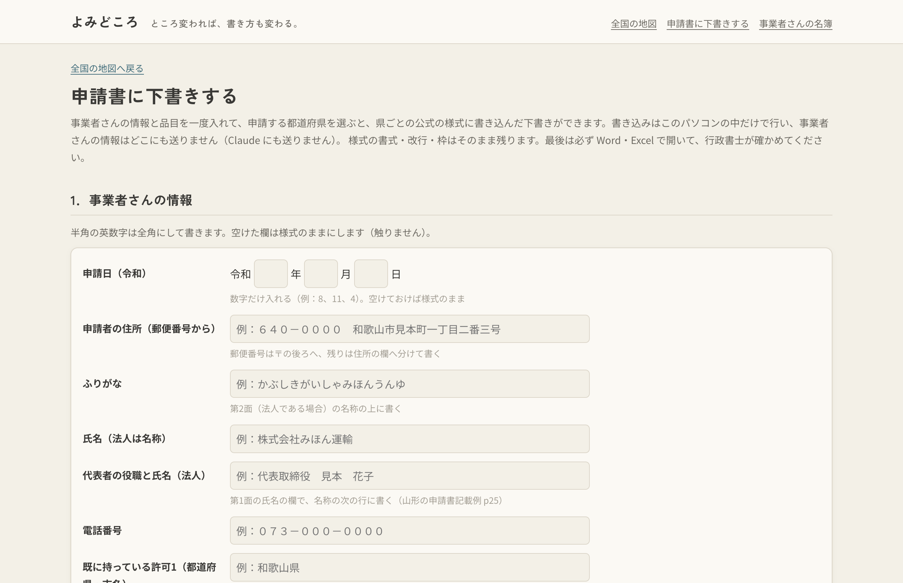

# よみどころ

**ところ変われば、書き方も変わる。**

このプロジェクトは、行政書士の「県ごとに違う、手引きに載っていない決まり」を、手引きと電話で聞いた答えを出典つきで一枚の地図にし、申請書の下書きまでつなぐ、自分専用の道具です。一本目は、産業廃棄物収集運搬業の許可（特別管理産業廃棄物と積替保管を含まない収集運搬）。

- 47都道府県の手引きを Claude が読み、2,563件の記録に出典のページを付けました。引用はプログラムが手引きの本文と照合し、不一致 0・近似 3（うち1件は人が目視して一致、2件は目視待ち）。人が1件ずつ手引きと照らした記録は 91件中 91件が正しい。Claude の引用を Claude に確かめさせないのが、PDF を AI に入れて要約させるのと違う所です
- 役所に電話で聞いた答えは、メモや議事録をそのまま渡すと Claude が観点ごとに整え、担当者の名前を消し、手引きと食い違えば「揺れあり」の印を付けます。どちらが正しいかは道具が決めません。行政書士が決めます
- 様式への記入では、事業者さんの情報を Claude にもインターネットの向こうにも送りません。様式への書き込みはパソコンの中だけ。分からない所は【要確認】で残し、道具が事実を作りません

**ブラウザで3分で試す**

1. 電話の答えが地図に載った形：https://yomidokoro.vercel.app/27/?手続き=変更許可&品目=廃油 （大阪府。作者の実際の電話の記録から、依頼者の情報を除いて載せた7件。品目を「がれき類」に変えると答えが入れ替わります）
2. 電話で聞くことのチェックリスト：https://yomidokoro.vercel.app/30/ （和歌山県。「聞くことをコピーする」で、そのまま議事録に貼れます）
3. 申請書の下書き：https://yomidokoro.vercel.app/shoshiki/ （「様式を手で置く」の「まず試すなら」で和歌山の様式を読み込み、架空の会社で下書きまで。山形・奈良・愛知・京都と、事業者さんの名簿はアプリ版で。下の「審査員の方へ」）
4. デモ動画（3分）：

動画の画面は 2026-11-05〜06 に撮ったもので、その時点の数字（44 都道府県・2,427 件、下書きは三〜四県）が映っています。公開版とこのリポジトリはその後の直し（47 都道府県・2,563 件、下書きは五県、愛知の記載例の形）を含みます。1:28 からの電話メモの住所・車両番号・担当者名は録画用の架空のものです。取り込みは住所・車両番号を記録から外して「止めた情報」と出しますが、動画ではその行を省いています（下の「守っていること」）。

| 電話の答えが地図に（大阪） | 電話で聞くこと（和歌山） |
|---|---|
|  |  |

| 全国の地図 | 申請書に下書きする |
|---|---|
|  |  |

---

## 困りごと

産廃の収集運搬は、運ぶ先の県ごとに許可がいります。法律は一つですが、手引きは県の数だけあり、書き方の決まりも県ごとに違います。

- 提出部数、事前予約の要否、添付書類の独自様式、手数料の納め方、排出事業者や運搬先をどこまで具体的に書くか
- 本当に困るのは手引きに載っていない部分です。窓口に電話するしかなく、担当者によって答えが違うこともあります
- 初めての県では「どこを見ればいいか」（県で違いやすい点）が分からず、手引きを頭から読むことになります。電話で聞くことも、読み終わってやっと分かります。聞いた答えはメモや議事録に残っても、県・品目・観点で結びついていないので、次の案件で引けません

作者（行政書士）はこれまで 12 府県に産廃収集運搬の許可を申請してきました。公開版の受理実績2件（兵庫）と電話の記録7件（大阪）は、その記録から依頼者の情報を除いたものです。それでも初めての県は手引きを読むだけで半日、窓口への電話が2回ほどかかっていました。使う前は、たいてい1回は補正（審査で直すよう言われること）がありました。

使った後の数字（2026-11-05、作者が画面録画で測った。秋田県、道具に入れていない県で、手引きの PDF を県のサイトから落として「提出部数・事前予約・手数料の納め方」の三つを探した）：
- 道具なし：県のサイトを探して PDF を落とすまで 38 秒、PDF の中を探して三つ見つけるまで 2 分 37 秒。合わせて **3 分 27 秒**。三つとも、道具の記録と同じ答えだった
- 本当に大変なのはその先だった。事業計画の概要と別紙（排出事業者が決まるまで書けない所、性状をどこまで具体的に書くか）。だから道具は「電話で聞くこと」の中に「事業者さんの状況で変わること」を出し、申請書の下書きまでつないだ

## できること

1. **県を押すと、手引きの要点が観点32項目ごとに出典のページつきで並ぶ。** 手引きに明記／窓口に電話で確認／受理実績／同業者から聞いた／補正、を札で分けます
2. **手引きに無いことは「電話で聞くこと」のチェックリストに出る。** 書き写してメモ帳に貼り、電話をしながら埋められます
3. **電話のメモや議事録をそのまま渡すと、Claude が整えて記録する。** 音声入力で話した文でもよい。観点ごとに分け、担当者の名前を消し、日付と課名だけを残します。同じ県の手引きや前の電話と食い違えば「揺れあり、要確認」の印が付きます
4. **県の様式に下書きする。** 事業者さんの情報を一度入れ、品目を選び、申請する県に印を付けて「作成」を押すと、道具が県のサイトから様式を取ってきて、県の数だけ下書きを作ります（和歌山・山形・奈良・愛知の申請書。愛知は事業計画の概要も。山形は事業計画の概要の別紙に、全体計画・品目ごとの運搬量と性状・運搬先・車両・具体的な計画・環境保全措置の文まで。2026-11-05 に作者が Word で確かめた。マスの行数に入らない文は道具が落として【要確認】に出し、勝手に詰めません）。愛知は県のサイトが自動の取得を断るので、県のページから様式を保存して画面に置きます（道具はボット対策を回り道しません）。事業者さんは「名簿」に残り、次の県はその名簿から作れます。和歌山は誓約書（第10面と別紙4）にも住所・名称・代表者が入り、車両の前面・側面と容器の写真（PNG・JPEG）を選ぶと、写真の面（第6面・第7面）に枠の大きさに合わせて貼ります（2026-11-06 に足した。写真は名簿にも残さず、このパソコンの中だけ）。書き込みは全部このパソコンの中だけ。分からない所は【要確認】で残し、道具が事実を作りません
5. **書ける県を Claude のスキルで増やす。** 「〇〇県の申請書も書けるようにして」と Claude Code に頼むと、スキル「様式を診断する」が県のページから白紙の様式を取ってきて、何でできているかと道具で書けるかを診断し、「どこに何を書くか」の対応表の下書きと架空の事業者での試しを作ります。スキル「書き方を読む」は、県の手引きの記載例から事業計画の概要の「書き方の型」を作ります。どちらも、行政書士が試しを Word で見て「合っている」と言うまで道具に入りません。愛知と山形は、このスキルで一晩のうちに足しました
6. **はじめての許認可。** 許認可の名前と自治体を入れると、公式サイトだけから手引きを探して読み、共通の観点12項目と独自の観点を出典つきで出します（試した例：建設業許可・和歌山県、罹災証明書・和歌山市）

道具は判断しません。判断は行政書士がします。

## Claude が担うことと、担わないこと

| 工程 | 担うもの | モデル・機能 | なぜそれを選んだか |
|---|---|---|---|
| 手引きを読む（47都道府県） | Claude | Fable 5.1、Message Batches、プロンプトキャッシュ（1時間） | 長い PDF を正確に読ませたいので一番強いモデル。県をまとめて頼むと料金が半分、共通の指示はキャッシュで使い回す |
| 引用が本当に手引きにあるか確かめる | プログラム | なし（文字の照合） | Claude の引用を Claude に確かめさせない。2,563件のうち一致 2,560、近似 3（1件は人が目視して一致、2件は目視待ち）、不一致 0 |
| 電話メモを整える | Claude | Opus 5.5、構造化出力、ストリーミング | 決まった形（観点・問い・答え・対象）で返させる。端末では書いた所から順に見える |
| 個人名・依頼者情報を消す | Claude とプログラム | Opus 5.5 → 正規表現 → Haiku 5.5 | 三段で見て、どれかに引っかかれば保存しない |
| 手引きと電話の食い違いを見立てる | Claude | Opus 5.5 | 五択（一致・補足・食い違い・対象が違う・判定不能）と理由一行。印を付けるだけで、どちらが正しいかは言わない |
| はじめての許認可で手引きを探す | Claude | Opus 5.5 とウェブ検索、Haiku 5.5（自治体のドメイン） | lg.jp・go.jp・自治体のドメインだけに絞る |
| 電話メモの取り込み手順 | Claude Code | Skill（denwa-memo） | 入口（音声入力・貼り付け・ファイル・議事録）を選び、保存前に見せて確認をもらう |
| 県の様式を診断して、書ける県を増やす | Claude Code | Skill（yoshiki-shindan）、診断のプログラム（`npm run 様式を診断`） | 白紙の様式を読んで対応表の下書きを作る。本物の事業者の情報は入れず、架空の事業者で試す。行政書士が Word で確かめてから道具に入れる |
| 県の記載例から「書き方の型」を作る | Claude Code | Skill（kakikata-yomu）、Fable 5.1 のサブエージェント | 県ごとに違う文の組み立てを記載例から写し、会社ごとに変わる所だけを共通の名前の空きにする。行ごとに出典のページと「まま／一部／組み替え」の印を残す。山形の型は Fable の手伝い役が記載例 p28〜p32 から作った |
| 様式に書き込む | プログラム | なし（docx・xlsx の中身を直接書き換える） | 事業者さんの情報を Claude にもネットにも渡さないため。様式は sha256 と箱の数で固定し、県が様式を改めたら書かずに止まる |
| 公開してはいけない物を止める | Claude Code とプログラム | フック（Bash の前）と git の pre-push | 電話の記録・様式の本体・鍵が公開側に混ざれば止める |
| どれが正しいか決める | **行政書士** | — | 道具は断定しない |

使っていないもの：Managed Agents、Agent SDK。手元のパソコンで、行政書士が自分の手で一工程ずつ確かめながら進める道具なので、使いませんでした。

## 守っていること

- **様式への記入では、事業者さんの情報（住所・氏名・生年月日・本籍・車両番号・電話番号など）を Claude にもインターネットの向こうにも送りません。** 様式への書き込みはブラウザ（またはアプリ）の中だけで行います。電話メモの取り込みは Claude に文を渡して整えるので、依頼者の情報は渡す前に消すのが決まりです。混ざっていても、Claude が住所・車両番号などを記録から外して「止めた情報：N件」と出し、正規表現と Haiku の再検査で残っていれば保存しません
- **共有する記録に、担当者の個人名は残しません。** 日付と窓口（課名）だけです。自分の手帳（自分のパソコンの中だけ）には、担当者の名前と「どの案件の電話か」を「手元だけ」の欄に残せます。この欄は公開版・見本・GitHub には出ません（書き出しの検査が止めます）
- **手引きの本文はこのリポジトリに置きません。** 置くのは URL、ファイルの指紋（sha256）、短い引用だけです。手元で読むときは `npm run 取得` で各自が取ってきます
- 例外は和歌山県の様式第六号1枚だけです。県の利用規約（出典を書けば再掲できる）に基づき、中身を変えずに載せています
- 電話の記録（`手帳/`）は公開しません。公開版の電話7件は、作者が2026年7月に大阪府に確かめた実際の記録から、依頼者の情報を除き、課名と年月だけにしたものです
- 手引きの改訂を検知したとき、または記録から1年たったときは「再確認」の印が付きます

## 試行錯誤の記録

**一番詰まった場面：207観点が黙って「記載なし」になっていた**

1. 何を作ろうとしていたか：都道府県の手引き（当時 44、今は 47）を Claude（Fable 5.1、Message Batches）に読ませ、観点32項目ごとに「手引きのどこに何と書いてあるか」を出典のページつきで抜き出す層
2. Claude にどう指示したか：観点の一覧（id と説明）を渡し、「観点 id ごとに、引用・ページ・要約を決まった形で返す」と指示した。返ってきた観点の名前をプログラムで照合し、一覧に無い名前は捨てる作りだった
3. 何が起きたか：和歌山の正解付けの準備で、「記載なし」と出ていた観点の多くに、実は手引きに答えがあると分かった。ログを見ると Claude は答えを返していた。ただし観点の名前に説明を付けて（「排出事業者（排出事業者の書き方）」）。プログラムが知らない名前として黙って飛ばしていた。35県・207観点
4. 期待と何が違ったか：Claude が「名前をそのまま返す」ことを疑わなかった。捨てる処理が黙っていたので、気づく手がかりが画面に出なかった
5. どう対処したか：名前を合わせる処理（括弧と説明を落として照合）を足し、合わない名前は黙って捨てず画面に出す。残っていた読み取りのログから拾い直したので、Claude を呼び直さずに 387件が戻った（引用の照合で不一致 0）。教訓は二つ。Claude の出力を受ける側は「少し違う形で返る」前提で作り、捨てるときは必ず見えるようにする。もう一つは今夜の山形で学んだ。「何も書かれない」はエラーより見つけにくい。道具は書く場所が無いときも黙らず、結果に出すべきだった

- 大阪の手引きの言い回しを Claude が言い換えて引用してしまった。引用の照合をプログラムにして、指示を直したら10府県で言い換えは0件になった
- 207観点が黙って「記載なし」になっていた（上の「一番詰まった場面」）
- 「揺れあり」は本物のデータでは1件も出ていない（手帳の125組：一致11・補足35・食い違い0・対象が違う63・判定不能16）。こしらえず、0件のまま出しています
- 和歌山の様式の改ページは、Word で案A〜B8 を見比べて決めた
- 県のサイトのボット対策は回り道しない。取れないときは手元にダウンロードした物を読む（愛知）
- Windows のアプリが、Mac と共有している場所では開かずに閉じた。場所を見て案内を出すようにした
- 愛知の誓約書で、会社名の下に書く代表者の名前が左に寄った。Word の字下げが最初の行にしか効かない作りだったため。次の行の頭に空白を置いてそろえた（作者が Word で見て気づいた）
- 山形の事業計画の概要の別紙に文を入れようとしたら、何も書かれずに通った。段落の方式の書き込みに「文の欄」を書く仕組みが無かった（和歌山の箱の方式にしか無かった）。段落の方式にも足した
- 県のサイトから取ってくる口の引数名を `sha256` にしたら、同じ名前の関数が隠れて取り寄せが全部失敗した。通しの試し（まっさらなアプリで四県）で見つけた

**和歌山の正解付け（2026-11-05、作者が手引きと1件ずつ照らした）**
- Claude が手引きから取った記録：71件のうち71件が正しい
- 観点32で見ると、31が正しい。誤りの1つは排出事業者で、様式記載例の表にある具体名の例を拾えず「記載なし」と答えていた
- 手引きにあるのに拾えなかった文が2件。人が足した記録として入れ、画面にもそう出している
- 兵庫と奈良は抜き取りで10件ずつ見た（選び方は固定の計算で、誰がやっても同じ10件）。どちらも10件中10件が正しい。人が見た記録は合わせて91件中91件が正しい。抜き取りの県は拾い漏れまでは調べていないので、画面の札は「照合済み」のままにしている
- 作者の手元の手引きは、11月2日の改訂より前の版だった。道具は取得日と指紋（sha256）で版を押さえていたので、同じ版に揃えて付け直せた

## 審査員の方へ（試す道は三つ）

1. **公開版（ブラウザ。鍵もログインも要らない）** https://yomidokoro.vercel.app 。全国の地図から県を押すと、手引きの要点が観点ごとに出典のページつきで並びます。左の「観点を探す」で絞れます。「府県くらべ」で同じ観点を県ごとに並べられます。電話の記録は大阪府の見本7件だけ（作者の実際の記録から依頼者の情報と担当者名を除いたもの）
2. **アプリ版（zip を展開して開く）** このリポジトリの Releases にある `yomidokoro-0.0.6-win-x64.zip`（ふつうの Windows）、`-win-arm64.zip`（Mac の Parallels など ARM の Windows）、`-arm64-mac.zip`（Apple のチップの Mac。Intel の Mac は未対応）。三つあるのは、作者が Mac を使う行政書士で Word は Parallels の Windows で使い、同業の多くは Windows 機だからです。署名していないので、開くときに一度だけ警告が出ます。開き方と注意は `desktop/README.md`。「申請書に下書きする」の「見本の会社で試す」を押すと、架空の会社（和歌山環境サービス株式会社）の情報・品目・車両・容器・写真が一度に入ります。県に印を付けて「作成」。和歌山・山形・奈良・愛知・京都の様式に下書きが書かれ、書類の「よみどころ_下書き」の下に、事業者さんごと（会社名_新規）・県ごとのフォルダで残り、作成のあとそのフォルダが開きます。様式は県のサイトから道具が取ってきます（愛知だけは画面の案内に従って手で保存）。車両と容器の写真は画面で選んだものを貼ります（見本の絵は `docs/デモ写真/`）。事業者さんの情報はパソコンの外に出ません
3. **Claude Code で育てる（開発者向け）** このリポジトリを複製して `claude` を開き、「〇〇県の申請書も書けるようにして」と頼むと、スキル（`.claude/skills/yoshiki-shindan`）が県の様式と記載例を読み、対応表と書き方の型を作ります。 京都府はこのスキルで一回で作った県です。何を読んでどう決めたかは分析表 `app/data/様式/26_京都_分析.md`、どこに書くかは対応表 `app/data/様式/26_京都_*.yaml`、何をどう書くかは型 `app/data/書き方の型/26_京都_事業計画の概要.yaml` に、記載例のページつきで残っています。手引きの取得・読み込みと電話メモの取り込みは Claude の API キー（`app/.env`）が要ります

## 使い方（手元で動かす）

- ブラウザだけで試す：上の「ブラウザで3分で試す」。公開版は静的な書き出しで、サーバー処理も鍵もありません
- 地図を手元で見る：`cd app && npm install && npm run dev`
- 申請書に下書きする（アプリ）：`desktop/README.md` の zip を展開して開く → 上の帯「事業者さんの名簿」→「新しい事業者さんを入れる」→ 事業者さんの情報・品目・申請する県 →「作成」。下書きは書類の「よみどころ_下書き」に残る
- 書ける県を増やす（Claude Code）：`claude` を開いて「〇〇県の申請書も書けるようにして」（スキル yoshiki-shindan）、「〇〇県の事業計画の概要も書けるようにして」（スキル kakikata-yomu）。手順は `.claude/skills/*/SKILL.md`
- 手引きを取ってくる・読む：`npm run 取得 -- <県コード>`、`npm run 読む -- <県コード>`（Claude の API キーが要る。`app/.env` に置く）
- 電話メモを取り込む：`npm run 取込 -- 貼付`
- アプリ（Windows・Mac）：`desktop/README.md`

## 他の行政書士が使うには

1. **自分専用の地図を持つ（今）。** このリポジトリを複製し、自分の電話の記録を `手帳/` に溜めます。観点・指示文・書き方の型は文書ファイルなので、文を書き換えるだけで味付けできます
2. **Claude Code の拡張として配る（次）。** 手引きの層（共有してよい辞書）と、電話の層（自分の手帳）を分けて配ります
3. **ウェブの道具にする（その先）。** 支部での共有、同業者向けの道具

他の許認可（建設業・車庫証明など）は、観点のファイルと手引きのフォルダを足して広げます。

## この先（許認可を増やし、経験を貯める）

この道具が目指すのは、行政書士が調べたこと・電話で聞いたこと・受理された実績を、許認可ごとの地図に貯めていき、経験が増えるほど厚くなる自分の手帳です。産廃で作った部品（公式サイトから手引きを探して読む、観点ごとに出典つきで並べる、様式を診断して対応表と型を作る、電話メモを観点に整える、揺れと再確認の印）を、許認可を引数にして回す形にします。

- 「新しい許認可」を押す → 公式サイトから下調べ（今ある） → その許認可の観点を Claude が提案し、行政書士が決める → 47 自治体の手引きを読んで地図に → 県の様式を診断して入力欄に
- Claude が要る作業は Claude Code のスキルとして動き、公開版とアプリ版は地図と対応表を読むだけ。事業者さんの情報は今までどおり外に出しません
- 受理実績を取込で入れ、案件から学んだ書き方が次の申請の根拠になる。支部や同業者には、名前を外した形で共有する

設計は `構成/20_次の設計_許認可を増やして経験を貯める.md`。提出後に、建設業許可を二つ目の許認可として通します。

## 期間と範囲

- ハッカソン「Built with Claude: Japan 2026」の期間中（2026-11-02 12:00〜）に作りました。構想と設計のメモは期間前に作り、コードは期間中に書きました
- 対象外：特別管理産業廃棄物、積替保管を含む手引きの読み込み。様式の下書きは五県（和歌山・山形・奈良・愛知・京都）。ほかの県はスキルで足していく

## 次にやること

1. Excel の様式（奈良）に写真を貼る。2台目以降の車両の写真の面
2. 名簿の「手元だけ」の欄を画面で直せるようにする。福岡など古い形（.doc）の様式の扱い
3. アプリのボタンからスキルを呼ぶ。Claude Code を入れている人が、画面の「この県も書けるようにする」を押すだけで県を増やせる形。運営に `claude -p` の扱いを確かめてから
4. 作成のときに、申請に要る様式（別紙・誓約書など）を全部取ってきてフォルダに入れる
5. 他の許認可（建設業・車庫証明）、「写真から図面を起こす」（農地転用）

## ライセンスと断り書き

- コード：MIT（`LICENSE`。名義 Mi.Like合同会社）
- 観点・記録の YAML：CC BY 4.0
- 手引き・様式は各都道府県の著作物です。出典と利用規約は各県の `_出典.yaml` と画面に記載しています
- この道具は、行政書士が自分の業務に使うために公開情報と自分のメモを整理したものです。申請の前に、必ず窓口で再確認してください

## デモ動画の素材の出典

- 音楽：Suno（有料プラン）で生成した曲「Softly Answered」「Gently Forward」「Little Signals」（2026-11-05 生成）。制作者から本動画への使用許諾あり
- 効果音：Artlist（ライセンス取得済みのアカウントからダウンロード。本動画への使用許諾あり）
  - Vadi Sound「Qwerty - Computer Keyboard Quick Typing」
  - InspectorJ「Working From Home - Computer Mouse Single Click」
  - DeanKR「Christmas Vibes - Twinkling Tap」
- 手引き・様式：各都道府県の公開資料（出典 URL は `手引き/<県>/_出典.yaml`）。動画には京都府「産業廃棄物処理業許可申請の手引き」の記入例（26 ページ）と、和歌山県「様式記載例」（1 ページ）、和歌山県・愛知県・奈良県の様式に道具が書いた下書きを映している
- 実写・ナレーション：自分で撮影・録音。申請書の記入内容・事業者名・担当者名は架空
- 動画の制作：Remotion（React）。道具の画面は本物の画面録画
